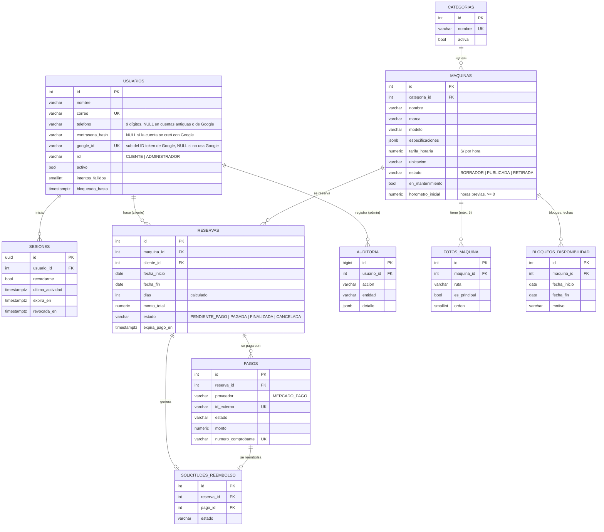
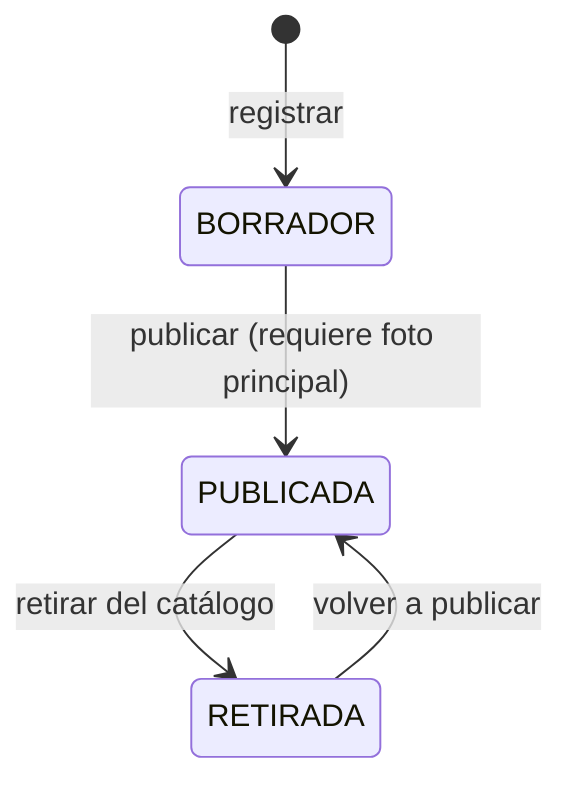

# Base de datos (EN-02)

Motor: **PostgreSQL 14+**. El esquema completo vive en un solo script, `database/migrations/001_esquema_inicial.sql`, que el backend aplica al arrancar si la base de datos aun no lo tiene registrado.

El script crea todas las tablas del sistema: usuarios (con login por correo o Google), sesiones, categorias, maquinas (tarifa y combustible por hora), fotos, bloqueos de disponibilidad, reservas por horas, pagos, solicitudes de reembolso y auditoria. Las reglas de negocio que la base de datos puede garantizar por si sola (horarios que no se superponen, maximo 5 fotos por maquina, una foto principal, correo unico) estan definidas ahi como restricciones.

Para cambios futuros del esquema se agregan migraciones nuevas (`002_...sql`, `003_...sql`, etc.) y no se edita el `001`. Cada migracion se aplica una sola vez, en orden, y su nombre queda registrado en la tabla `schema_migraciones`.

## Diagrama entidad-relación



## Reglas de negocio que garantiza la propia base de datos

| Regla | Historia | Cómo se garantiza |
|---|---|---|
| Solo existen los roles CLIENTE y ADMINISTRADOR | EN-05 | `CHECK (rol IN ('CLIENTE','ADMINISTRADOR'))` (`usuarios_rol_check`). Las máquinas son del negocio: no hay proveedores |
| El celular es de 9 dígitos y empieza con 9 | HU-02 | `ck_usuarios_telefono`: `telefono IS NULL OR telefono ~ '^9[0-9]{8}$'`. Se guarda sin espacios ni `+51`. Es obligatorio al registrarse (lo exige el backend), pero admite `NULL` para no romper las cuentas creadas antes |
| El correo no se repite | HU-01 | Índice único `ux_usuarios_correo` (los correos se guardan en minúsculas) |
| La contraseña se guarda cifrada | HU-01 | Solo existe la columna `contrasena_hash` (PBKDF2-SHA256 con sal) |
| Toda cuenta tiene una forma de entrar | Google | `ck_usuarios_forma_de_ingreso`: `contrasena_hash IS NOT NULL OR google_id IS NOT NULL`. Una cuenta creada con Google no tiene contraseña y el login normal la rechaza siempre |
| Una cuenta de Google se vincula a un solo usuario | Google | Restricción única `ux_usuarios_google_id` |
| Nombre de categoría único | HU-14 | Índice único sobre `lower(trim(nombre))` |
| Cada máquina tiene exactamente una categoría | HU-14 | `categoria_id NOT NULL` + FK con `ON DELETE RESTRICT` |
| Máximo 5 fotos por máquina | HU-08 | Trigger `tg_fotos_max` |
| Solo una foto principal | HU-08 | Índice único parcial `ux_fotos_una_principal` |
| Bloqueos sin superponerse | HU-09 | Restricción de exclusión GiST con `daterange` |
| Dos reservas vigentes no ocupan las mismas fechas | HU-05 | Restricción de exclusión sobre reservas `PENDIENTE_PAGO` o `PAGADA` |
| Dos reservas vigentes no se solapan (con margen) | HU-06 | Restricción de exclusión GiST sobre `reservas`: `ex_reservas_sin_solapamiento EXCLUDE USING gist (maquina_id WITH =, tstzrange(fecha_inicio, fin_bloqueo, '[)') WITH &&) WHERE (estado <> 'CANCELADA')`. `fin_bloqueo = fecha_fin + 1 hora` (margen automático). |
| Reserva por horas mínima de 1 hora en el mismo día | HU-06 | `CHECK (fin > inicio)` + validación backend (misma fecha, solo horas 7-19) |
| Un webhook duplicado no confirma dos veces | HU-06 | Índice único `(proveedor, id_externo)` en pagos |
| Retirar una máquina no borra su historial | HU-08 | Reservas usan `ON DELETE RESTRICT`; retirar = cambiar `estado` |

## Filtros del catálogo (HU-03, HU-06)

El catálogo filtra directamente en SQL (no en memoria), sobre la misma condición `WHERE` para la página y para el `count(*)` del total, así la paginación siempre coincide con los filtros:

| Filtro | Condición |
|---|---|
| Categoría | `m.categoria_id = ?` |
| Palabra clave | `lower(m.nombre) LIKE ? OR lower(m.marca) LIKE ?` |
| Precio mínimo (HU-06) | `m.tarifa_horaria >= ?` |
| Precio máximo (HU-06) | `m.tarifa_horaria <= ?` |

## Horas de uso de una máquina (horómetro)

`horasUso` no se guarda en ninguna columna: se calcula en cada consulta con una subconsulta escalar (no duplica filas ni altera la paginación):

```sql
m.horometro_inicial + COALESCE((SELECT sum(r.horas) FROM reservas r
                                 WHERE r.maquina_id = m.id AND r.estado = 'FINALIZADA'), 0)
```

- `reservas.horas` es la columna generada de la migración 003 (horas completas de la reserva).
- Es una **aproximación**: cuenta las horas alquiladas a través del sistema, no es una lectura real del motor. Por eso el administrador puede fijar un `horometro_inicial` (p. ej. al registrar una máquina usada).
- Mientras no exista el flujo de reservas (Sprint 3), `horasUso = horometro_inicial`. Cuando una reserva pase a `FINALIZADA`, la cifra sube sola sin más cambios.

| Regla | Cómo se garantiza |
|---|---|
| El horómetro inicial no es negativo | `ck_maquinas_horometro_inicial CHECK (horometro_inicial >= 0)`; el backend además limita a 999999.9 |

## Estados de una máquina



`en_mantenimiento` es independiente del estado: una máquina publicada en mantenimiento sigue en el catálogo con un aviso, pero en su detalle se muestra el aviso en lugar de la ficha (HU-04).
